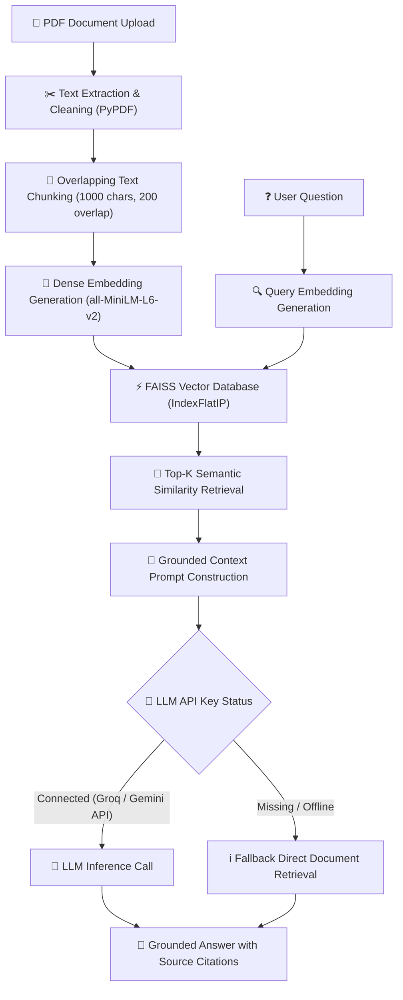

# 📚 DocuMind AI — Technical Project & Resume Portfolio Documentation

**DocuMind AI** is an enterprise-grade, privacy-focused **Retrieval-Augmented Generation (RAG)** application built with **Python, Streamlit, Sentence Transformers, FAISS, and Groq / Gemini AI APIs**. It allows users to upload PDF documents, index them using semantic vector embeddings, and interact with an AI assistant that delivers strictly grounded answers with exact source citations.

---

## 🎯 Executive Summary

- **Project Name**: DocuMind AI (PDF Document Assistant)
- **Domain**: Artificial Intelligence / Natural Language Processing (NLP) / Vector Search
- **Primary Use Case**: Document QA, Research Analysis, Contract Review, Technical PDF Querying
- **Core Technology Stack**: Python 3.11, Streamlit, PyPDF, Sentence-Transformers (`all-MiniLM-L6-v2`), FAISS Vector Index, Groq API (`openai/gpt-oss-120b`, `qwen/qwen3.8-27b`), Google Gemini API (`gemini-2.5-flash`), NumPy, Python-Dotenv
- **Key Differentiator**: Hybrid multi-LLM API key support with auto-detection, sub-millisecond similarity search, strict context grounding to prevent hallucinations, and automatic retrieval-only fallback mode.

---

## 🏗️ System Architecture & Data Flow



---

## 🚀 Key Technical Features

1. **Robust Text Extraction & Normalization**:
   - Page-by-page extraction using PyPDF.
   - Cleans null bytes, excessive spaces, and blank line runs.
   - Preserves source file names and page numbers for auditability.

2. **Context-Aware Overlapping Chunking**:
   - Configurable chunk size (default: 1000 characters) and overlap (default: 200 characters).
   - Preserves boundaries across sentence splits to avoid losing context between consecutive chunks.

3. **High-Performance Dense Vector Search**:
   - Uses HuggingFace `sentence-transformers/all-MiniLM-L6-v2` generating 384-dimensional normalized vector embeddings.
   - Leverages **FAISS `IndexFlatIP`** (Inner Product) for cosine similarity retrieval operating at sub-millisecond latencies.

4. **Multi-LLM Provider Engine with Auto-Detection**:
   - Supports both **Groq API** (`GROQ_API_KEY`, `VITE_GROQ_API_KEY`) and **Google Gemini API** (`GEMINI_API_KEY`, `GOOGLE_API_KEY`).
   - Automatically detects active API keys from `.env` and initializes the corresponding client.
   - Supported Groq models: `openai/gpt-oss-120b`, `qwen/qwen3.8-27b`, `openai/gpt-oss-20b`.

5. **Strict Anti-Hallucination Grounding**:
   - Custom system prompt enforces that answers are generated *strictly* using retrieved PDF snippets.
   - Returns explicit failure notices when requested information is absent from the uploaded PDFs.

6. **Retrieval-Only Fallback Mode**:
   - If an API key is missing or encounters a rate limit, the system gracefully degrades to presenting top-matching document excerpts with similarity scores.

---

## 💼 Resume & Portfolio Showcase

### 📌 Resume Bullet Points (Copy & Paste for Resume)

> **AI / RAG Engineer Project Bullet Points:**
> - **Architected & Deployed DocuMind AI**: Engineered a full-stack Retrieval-Augmented Generation (RAG) system in Python & Streamlit using Sentence Transformers (`all-MiniLM-L6-v2`) and FAISS vector search to perform sub-millisecond semantic retrieval across multi-page PDF documents.
> - **Multi-LLM Integration & API Management**: Integrated Groq API (`openai/gpt-oss-120b`, `qwen/qwen3.8-27b`) and Google Gemini API with automated key validation, dynamic prompt engineering, and fallback retrieval mechanisms.
> - **Optimized Retrieval & Grounding**: Implemented overlapping text chunking (1000/200 chars) and cosine similarity indexing with FAISS `IndexFlatIP`, eliminating LLM hallucinations by enforcing strict document-context grounding and source citations.
> - **Enterprise Error Handling & UI**: Designed an interactive Streamlit UI featuring document status monitoring, similarity score badges, source expanders, and session state persistence.

---

## 🛠️ Project Structure

```
documind-rag/
├── .env                  # Environment variables & API key configuration
├── .gitignore            # Git ignore rules
├── app.py                # Streamlit web application frontend
├── requirements.txt      # Python dependencies
├── README.md             # Project README overview
├── PROJECT_DOCUMENTATION.md # Detailed technical & resume documentation
└── src/
    ├── __init__.py       # Package initializer
    ├── pdf_processor.py  # PDF text extraction and chunking pipeline
    ├── prompts.py        # Grounded RAG prompt template & rules
    ├── rag_engine.py     # Multi-LLM provider & answer generator engine
    └── vector_store.py   # Sentence Transformer & FAISS vector search engine
```

---

## 🔑 Environment & API Key Setup

Create or update your `.env` file in the project root:

```env
# Groq API Key Setup (Active & Tested)
GROQ_API_KEY=your_groq_api_key_here
VITE_GROQ_API_KEY=your_groq_api_key_here
GROQ_MODEL=openai/gpt-oss-120b

# Alternative: Google Gemini API Key Setup
# GEMINI_API_KEY=your_gemini_api_key_here
```

---

## ⚙️ How to Run the Application

1. **Activate Virtual Environment**:
   ```powershell
   .venv\Scripts\activate
   ```

2. **Install Dependencies**:
   ```powershell
   pip install -r requirements.txt
   pip install groq
   ```

3. **Launch Streamlit App**:
   ```powershell
   streamlit run app.py
   ```

4. **Access UI**:
   Open `http://localhost:8501` in your browser.

---

## 🧪 Interview Q&A Preparation Pointers

- **Q: Why use FAISS `IndexFlatIP` instead of `IndexFlatL2`?**  
  *A:* When vector embeddings are L2-normalized (as done in `VectorStore._encode_documents`), the Inner Product (dot product) is mathematically identical to Cosine Similarity. `IndexFlatIP` computes dot products directly, making cosine similarity calculation significantly faster and simpler.

- **Q: Why is chunk overlap necessary?**  
  *A:* Sentences or ideas that span the boundary between two chunks might lose critical semantics if split strictly. Overlap ensures that boundary information appears completely in at least one chunk.

- **Q: How does the system handle missing API keys?**  
  *A:* `RAGEngine` uses `is_configured()` to check key validity. If unconfigured or failing, it activates `_create_fallback_answer()` to return the highest-scoring raw chunk directly to the user, ensuring the app remains functional even without external API calls.
